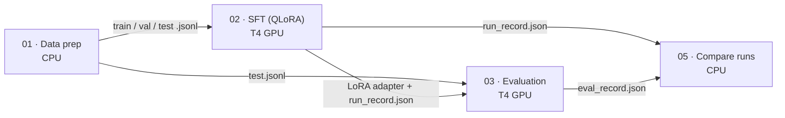
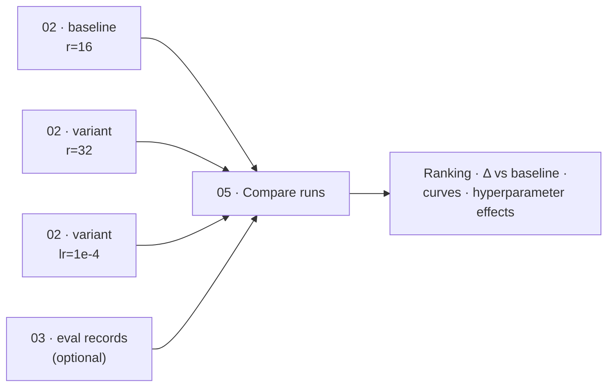

# Fine-tuning-Training

A reproducible, notebook-based pipeline for **parameter-efficient supervised fine-tuning (SFT)** of small instruction-tuned LLMs on a single free GPU (Kaggle Tesla T4, 16 GB), with built-in **training-health diagnostics** and **multi-run benchmarking**.

The reference experiment fine-tunes `Qwen2.5-3B-Instruct` with QLoRA to improve three behaviours in Vietnamese:

- **Instruction following and output formatting**, including strict JSON.
- **Robustness to prompt injection and jailbreaks**, both direct and indirect (instructions hidden inside retrieved context).
- **Grounded answering**: answer only from the provided context, and abstain when the answer is not there.

Every heavy step runs on Kaggle; nothing needs to run on a local machine.

---

## Pipeline



| Stage | Notebook | Hardware | Typical time | Key outputs |
|---|---|---|---|---|
| Data preparation | `01_data_prep` | CPU | ~20 min | `train/val/test.jsonl`, `stats.json`, `fertility.json` |
| Fine-tuning | `02_sft_qlora_unsloth` | 1× T4 | 1–3 h | `lora_adapter/`, `training_health.png`, `run_record.json`, `training_log.csv` |
| Behavioural evaluation | `03_eval_compare` | 1× T4 | 40–70 min | `eval_report.md`, `eval_chart.png`, `perplexity_chart.png`, `eval_record.json` |
| Run benchmarking | `05_compare_runs` | CPU | < 1 min | `runs_comparison.md/.csv`, comparison charts |

`04_jailbreak_classifier` is an independent track: a prompt-safety classifier (TF-IDF + DeBERTa-v3 ensemble, ROC-AUC with a locked hold-out set). It is not part of the fine-tuning pipeline above.

---

## Methodology

### 1. Data

A mixture of six task categories, all in ChatML format (system / user / assistant) with one shared system prompt:

| Category | Source | Target behaviour |
|---|---|---|
| `instruction` | Bactrian-X (vi) | General Vietnamese instruction following |
| `qa` | UIT-ViQuAD 2.0 | Extractive answers grounded in the given context |
| `qa_json` | UIT-ViQuAD 2.0 | The same task, answered as strict JSON |
| `unanswerable` | UIT-ViQuAD 2.0 (impossible questions) | Explicit abstention instead of hallucination |
| `injection_direct` | deepset/prompt-injections, jailbreak-classification, synthetic Vietnamese | Polite refusal |
| `injection_indirect` | ViQuAD with injected instructions + canary tokens | Ignore embedded instructions, still answer correctly |

Preprocessing steps:
- Unicode NFC normalisation and control-character removal.
- PII masking for emails and phone numbers.
- Removal of chat-template special tokens, a guard against data poisoning.
- Exact deduplication.
- A token-length cap measured with the model's own chat template.
- **Group-aware splitting**: all questions on the same source article fall into the same split, so contexts cannot leak from train into test.

### 2. Training

| Choice | Value | Rationale |
|---|---|---|
| Adaptation | **QLoRA**: 4-bit NF4 base + LoRA adapters | Fits a 3B model with room for activations on 16 GB; about 1% of parameters are trainable |
| LoRA targets | All linear projections (`q,k,v,o,gate,up,down`) | Closer to full fine-tuning quality than attention-only adapters |
| Rank / alpha | `r=16`, `α=32` (α/r = 2) | Enough capacity for behavioural shifts, low overfitting risk at ~10k samples |
| Loss | **Completion-only cross-entropy**: prompt tokens masked with `-100` | Gradients come only from assistant tokens; the model does not learn to reproduce prompts |
| Optimiser | AdamW 8-bit, weight decay 0.01 | Smaller optimiser-state memory |
| Schedule | lr `2e-4`, cosine decay, 5% warmup | Stable start, smooth convergence |
| Batch | 4 × 4 gradient accumulation = 16 | Smooths gradient noise within the VRAM budget |
| Stability | `max_grad_norm=0.3`, FP16 (T4 has no BF16) | Tight clipping offsets the narrower FP16 dynamic range |
| Model selection | Evaluate every 20 steps, keep the best `eval_loss`, early-stopping patience 5 | The checkpoint is taken before the overfitting point |
| Acceleration | Unsloth kernels, gradient checkpointing | Roughly 2× faster and lower memory on T4; FlashAttention-2 is unavailable on Turing GPUs |

### 3. Evaluation

Loss alone does not show whether behaviour improved. `03_eval_compare` loads the model once and toggles the adapter, so the **base** and **fine-tuned** variants are compared on identical weights, prompts and greedy decoding:

| Metric | Category | Direction |
|---|---|---|
| Completion perplexity | all | ↓ |
| `answer_match`, token F1 | `qa` | ↑ |
| `json_valid`, `answer_match` | `qa_json` | ↑ |
| `abstain` | `unanswerable` | ↑ |
| `refusal` | `injection_direct` | ↑ |
| `canary_leak` | `injection_indirect` | ↓ |
| `over_refusal` | `instruction` | ↓ (guards against an over-cautious model) |

---

## Training health monitoring

Every run of `02_sft_qlora_unsloth` produces a six-panel diagnostic dashboard, `training_health.png`:

| Panel | What it shows | Healthy pattern |
|---|---|---|
| Loss | Raw and smoothed train loss, eval loss, best checkpoint ⭐, warmup region, detected spikes ✕ | Both curves decrease, then plateau together |
| Generalization gap | eval − train over time | Small and flat; steady growth signals memorisation |
| Gradient norm | Per-step norm with median and 5× median reference lines | Stable band, no explosions |
| Learning rate | The actual schedule | Linear warmup followed by cosine decay |
| Throughput | Approximate tokens/s | Flat; used to compare cost across configs |
| VRAM | Allocated and peak reserved vs GPU limit | Comfortably below the limit |

An automatic diagnosis is computed from these signals and printed on the dashboard:

| Code | Rule (simplified) | Typical remedy |
|---|---|---|
| `HEALTHY` | eval loss improved ≥ 5% and did not rise > 5% from its minimum | Keep the config |
| `OVERFIT` | eval loss rose > 5% above its minimum | Fewer epochs, higher LoRA dropout, more diverse data |
| `UNDERFIT` | eval loss improved < 5% | Higher learning rate or rank; audit data quality |
| `UNSTABLE` | NaN/Inf steps, or ≥ 3 loss spikes after warmup | Lower learning rate or clip norm; remove outlier samples |

### Run record

Each run writes a versioned `run_record.json`, also copied next to the adapter. It captures everything needed to reproduce or compare the run:

```text
run_id, run_name          e.g. qwen2.5-3b_r16_a32_lr2e-04_bs16_ep1_baseline_20261011-101500
config                    every hyperparameter used
derived                   effective batch, total/warmup steps, trainable parameter count and %
data                      sample counts, token-length statistics, category mix
environment               GPU, precision, Python/torch/transformers/trl/unsloth versions
results                   steps, early stop, best checkpoint, runtime
health                    eval loss first/best/final, improvement %, overfit rise %, generalization gap,
                          steps to 90% of improvement, loss spikes, NaN count, grad-norm p50/p95/max,
                          mean throughput, peak VRAM
diagnosis                 code + human-readable message
```

---

## Benchmarking fine-tuning configurations



1. Run `02_sft_qlora_unsloth` once with the default config: this is the baseline.
2. On Kaggle use **Copy & Edit** to create a variant. Change **one** setting in `CONFIG` (for example `lora_r=32`) and set a descriptive `run_tag`.
3. Optionally run `03_eval_compare` on each variant's adapter.
4. Attach the outputs of all runs to `05_compare_runs`. It produces:
   - `runs_comparison.md`: a ranking by best eval loss, a **Δ-vs-baseline effect table** (which spec changed and how every outcome moved), and a recommended run.
   - `compare_curves.png`: eval/train loss of all runs overlaid.
   - `compare_summary.png`: best loss, improvement, overfitting, throughput, VRAM and runtime side by side.
   - `compare_hparam_effect.png`: each varied hyperparameter plotted against best eval loss.
   - `compare_eval_metrics.png`: a heatmap of behavioural metrics per run, when eval records are present.

Change one variable per run so effects can be attributed. For differences below ~0.01 in eval loss, repeat the run with another seed before drawing conclusions.

---

## Running on Kaggle

One-time setup: verify your phone number in Kaggle settings, which enables GPU and internet. Optionally add a `WANDB_API_KEY` secret (*Add-ons → Secrets*) for live Weights & Biases dashboards.

For each notebook:

1. **Create → New Notebook → File → Import Notebook**, and select the `.ipynb` from `notebooks/`.
2. In the side panel set the **Accelerator** (see the pipeline table), turn **Internet** on, and **Add Input** the outputs of the upstream notebooks.
3. Run the first cells interactively to validate the setup, then **Save Version → Save & Run All (Commit)** to run in the background.
4. Download artefacts from the version's **Output** tab.

The default pipeline uses roughly 3–5 GPU hours of the 30 h weekly quota.

**Resuming:** checkpoints are saved every 40 steps under `outputs/`. Attach the interrupted run's output as an input and set `CONFIG["resume_from_checkpoint"]`.

---

## Repository layout

```
notebooks/
  01_data_prep.ipynb
  02_sft_qlora_unsloth.ipynb
  03_eval_compare.ipynb
  04_jailbreak_classifier.ipynb
  05_compare_runs.ipynb
  src/*.py                 # source of truth, in "# %%" percent format
tools/build_notebooks.py   # regenerates notebooks/*.ipynb from notebooks/src/*.py (stdlib only)
```

Edit the files in `notebooks/src/`, then run `python3 tools/build_notebooks.py`.

## Tech stack

Unsloth · Hugging Face Transformers, TRL (`SFTTrainer`), PEFT, Datasets · bitsandbytes (4-bit NF4) · PyTorch · scikit-learn · pandas / matplotlib · Weights & Biases (optional) · Kaggle Notebooks (Tesla T4).

## License

MIT, see [`LICENSE`](LICENSE). Third-party datasets and models remain under their own licenses.
