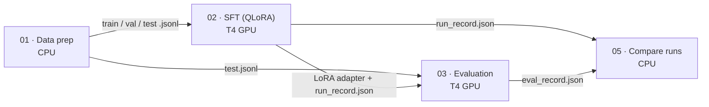
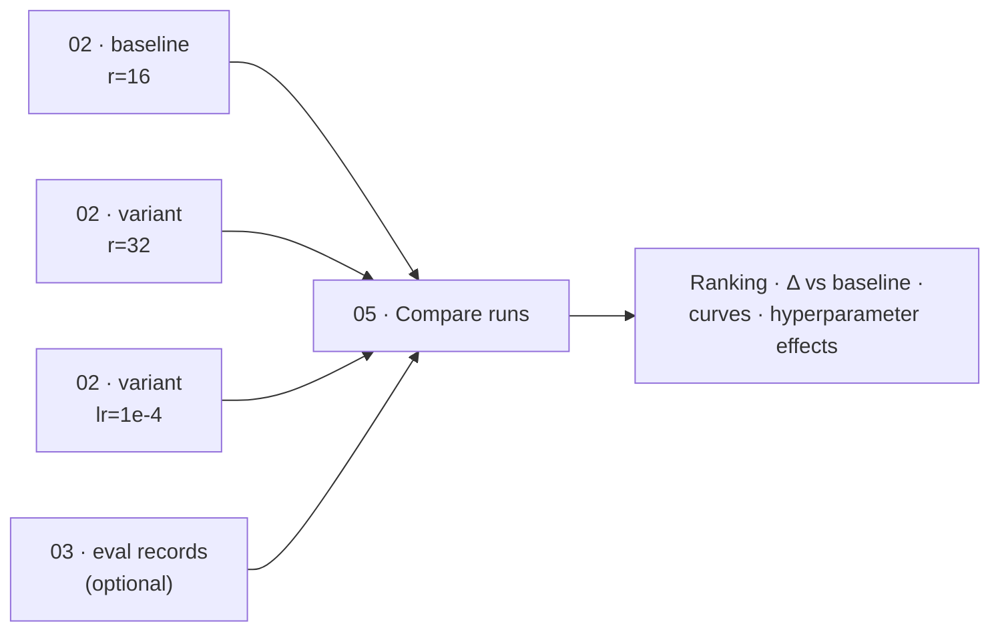
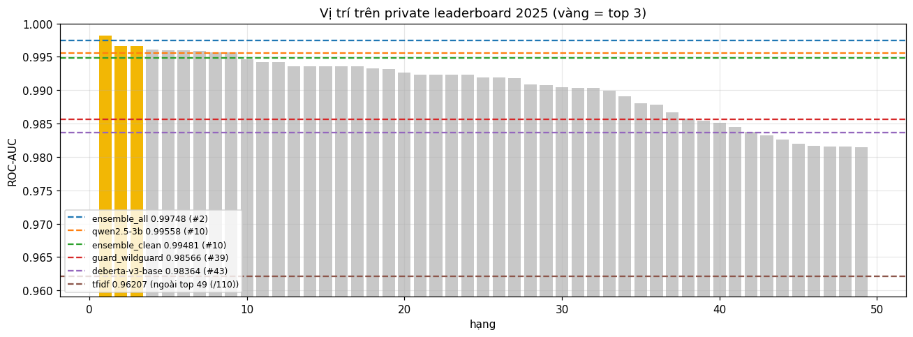
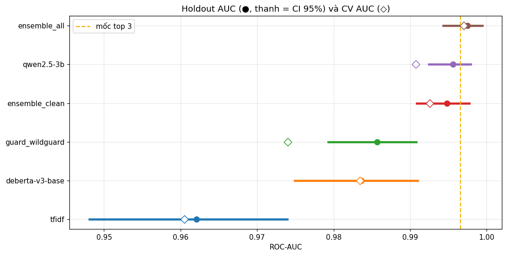
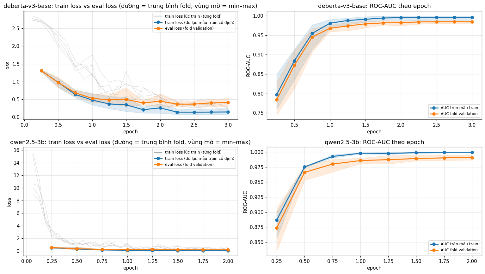
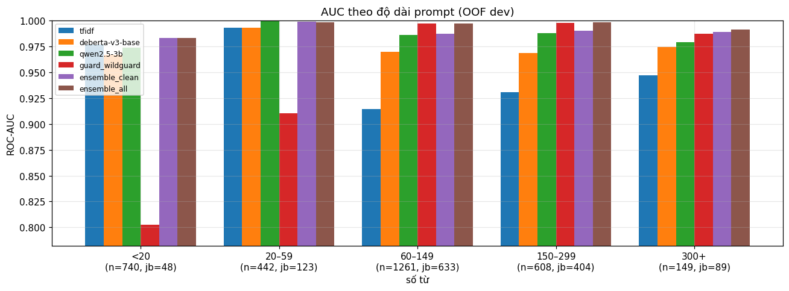

# LLM Safety Fine-tuning

A reproducible, notebook-based pipeline for **parameter-efficient supervised fine-tuning (SFT)** of small instruction-tuned LLMs on a single free GPU (Kaggle Tesla T4, 16 GB), with built-in **training-health diagnostics** and **multi-run benchmarking**.

The reference experiment fine-tunes `Qwen2.5-3B-Instruct` with QLoRA to improve three behaviours in Vietnamese:

- **Instruction following and output formatting**, including strict JSON.
- **Robustness to prompt injection and jailbreaks**, both direct and indirect (instructions hidden inside retrieved context).
- **Grounded answering**: answer only from the provided context, and abstain when the answer is not there.

Every heavy step runs on Kaggle; nothing needs to run on a local machine.

---

## Pipeline



| Stage | Notebook | Hardware | Typical time | Key outputs |
|---|---|---|---|---|
| Data preparation | `01_data_prep` | CPU | ~20 min | `train/val/test.jsonl`, `stats.json`, `fertility.json` |
| Fine-tuning | `02_sft_qlora_unsloth` | 1× T4 | 1–3 h | `lora_adapter/`, `training_health.png`, `run_record.json`, `training_log.csv` |
| Behavioural evaluation | `03_eval_compare` | 1× T4 | 40–70 min | `eval_report.md`, `eval_chart.png`, `perplexity_chart.png`, `eval_record.json` |
| Run benchmarking | `05_compare_runs` | CPU | < 1 min | `runs_comparison.md/.csv`, comparison charts |

`04_jailbreak_classifier` is an independent track: a prompt-safety classifier (benign vs. jailbreak / prompt injection) scored by ROC-AUC on a locked hold-out set. It is not part of the fine-tuning pipeline above. See [Prompt-safety classifier](#prompt-safety-classifier-notebook-04) below.

---

## Methodology

### 1. Data

A mixture of six task categories, all in ChatML format (system / user / assistant) with one shared system prompt:

| Category | Source | Target behaviour |
|---|---|---|
| `instruction` | Bactrian-X (vi) | General Vietnamese instruction following |
| `qa` | UIT-ViQuAD 2.0 | Extractive answers grounded in the given context |
| `qa_json` | UIT-ViQuAD 2.0 | The same task, answered as strict JSON |
| `unanswerable` | UIT-ViQuAD 2.0 (impossible questions) | Explicit abstention instead of hallucination |
| `injection_direct` | deepset/prompt-injections, jailbreak-classification, synthetic Vietnamese | Polite refusal |
| `injection_indirect` | ViQuAD with injected instructions + canary tokens | Ignore embedded instructions, still answer correctly |

Preprocessing steps:
- Unicode NFC normalisation and control-character removal.
- PII masking for emails and phone numbers.
- Removal of chat-template special tokens, a guard against data poisoning.
- Exact deduplication.
- A token-length cap measured with the model's own chat template.
- **Group-aware splitting**: all questions on the same source article fall into the same split, so contexts cannot leak from train into test.

### 2. Training

| Choice | Value | Rationale |
|---|---|---|
| Adaptation | **QLoRA**: 4-bit NF4 base + LoRA adapters | Fits a 3B model with room for activations on 16 GB; about 1% of parameters are trainable |
| LoRA targets | All linear projections (`q,k,v,o,gate,up,down`) | Closer to full fine-tuning quality than attention-only adapters |
| Rank / alpha | `r=16`, `α=32` (α/r = 2) | Enough capacity for behavioural shifts, low overfitting risk at ~10k samples |
| Loss | **Completion-only cross-entropy**: prompt tokens masked with `-100` | Gradients come only from assistant tokens; the model does not learn to reproduce prompts |
| Optimiser | AdamW 8-bit, weight decay 0.01 | Smaller optimiser-state memory |
| Schedule | lr `2e-4`, cosine decay, 5% warmup | Stable start, smooth convergence |
| Batch | 4 × 4 gradient accumulation = 16 | Smooths gradient noise within the VRAM budget |
| Stability | `max_grad_norm=0.3`, FP16 (T4 has no BF16) | Tight clipping offsets the narrower FP16 dynamic range |
| Model selection | Evaluate every 20 steps, keep the best `eval_loss`, early-stopping patience 5 | The checkpoint is taken before the overfitting point |
| Acceleration | Unsloth kernels, gradient checkpointing | Roughly 2× faster and lower memory on T4; FlashAttention-2 is unavailable on Turing GPUs |

### 3. Evaluation

Loss alone does not show whether behaviour improved. `03_eval_compare` loads the model once and toggles the adapter, so the **base** and **fine-tuned** variants are compared on identical weights, prompts and greedy decoding:

| Metric | Category | Direction |
|---|---|---|
| Completion perplexity | all | ↓ |
| `answer_match`, token F1 | `qa` | ↑ |
| `json_valid`, `answer_match` | `qa_json` | ↑ |
| `abstain` | `unanswerable` | ↑ |
| `refusal` | `injection_direct` | ↑ |
| `canary_leak` | `injection_indirect` | ↓ |
| `over_refusal` | `instruction` | ↓ (guards against an over-cautious model) |

---

## Training health monitoring

Every run of `02_sft_qlora_unsloth` produces an eight-panel diagnostic dashboard, `training_health.png`:

| Panel | What it shows | Healthy pattern |
|---|---|---|
| Loss | Logged train loss, a fixed train-probe loss, eval loss, best checkpoint ⭐, warmup region, detected spikes ✕ | Probe and eval decrease, then plateau together. Logged train loss is not on the same scale |
| Generalization gap | eval − train probe over time | Small and flat; steady growth signals memorisation |
| Gradient norm | Per-step norm with median and 5× median reference lines | Stable band after the first steps, no explosions |
| Learning rate | The actual schedule | Linear warmup followed by cosine decay |
| Throughput | Approximate tokens/s | Flat; used to compare cost across configs |
| VRAM | Allocated and peak reserved vs GPU limit | Comfortably below the limit |
| Eval loss by category | Validation loss before training (LoRA B = 0, so this is the base model) and after | Every category drops |
| Change by category | Percent change in that loss | Negative (green) means the behaviour was learned |

An automatic diagnosis is computed from these signals and printed on the dashboard:

| Code | Rule (simplified) | Typical remedy |
|---|---|---|
| `HEALTHY` | eval loss improved ≥ 5% and did not rise > 5% from its minimum | Keep the config |
| `OVERFIT` | eval loss rose > 5% above its minimum | Fewer epochs, higher LoRA dropout, more diverse data |
| `UNDERFIT` | eval loss improved < 5% | Higher learning rate or rank; audit data quality |
| `UNSTABLE` | NaN/Inf steps, or ≥ 3 loss spikes after warmup | Lower learning rate or clip norm; remove outlier samples |

### Run record

Each run writes a versioned `run_record.json`, also copied next to the adapter. It captures everything needed to reproduce or compare the run:

```text
run_id, run_name          e.g. qwen2.5-3b_r16_a32_lr2e-04_bs16_ep1_baseline_20261011-101500
config                    every hyperparameter used
derived                   effective batch, total/warmup steps, trainable parameter count and %
data                      sample counts, token-length statistics, category mix
environment               GPU, precision, Python/torch/transformers/trl/unsloth versions
results                   steps, early stop, best checkpoint, runtime
health                    eval loss first/best/final, improvement %, overfit rise %, generalization gap,
                          steps to 90% of improvement, loss spikes, NaN count, grad-norm p50/p95/max,
                          mean throughput, peak VRAM
diagnosis                 code + human-readable message
```

---

## Benchmarking fine-tuning configurations



1. Run `02_sft_qlora_unsloth` once with the default config: this is the baseline.
2. On Kaggle use **Copy & Edit** to create a variant. Change **one** setting in `CONFIG` (for example `lora_r=32`) and set a descriptive `run_tag`.
3. Optionally run `03_eval_compare` on each variant's adapter.
4. Attach the outputs of all runs to `05_compare_runs`. It produces:
   - `runs_comparison.md`: a ranking by best eval loss, a **Δ-vs-baseline effect table** (which spec changed and how every outcome moved), and a recommended run.
   - `compare_curves.png`: eval/train loss of all runs overlaid.
   - `compare_summary.png`: best loss, improvement, overfitting, throughput, VRAM and runtime side by side.
   - `compare_hparam_effect.png`: each varied hyperparameter plotted against best eval loss.
   - `compare_eval_metrics.png`: a heatmap of behavioural metrics per run, when eval records are present.

Change one variable per run so effects can be attributed. For differences below ~0.01 in eval loss, repeat the run with another seed before drawing conclusions.

---

## Running on Kaggle

One-time setup: verify your phone number in Kaggle settings, which enables GPU and internet. Optionally add a `WANDB_API_KEY` secret (*Add-ons → Secrets*) for live Weights & Biases dashboards.

For each notebook:

1. **Create → New Notebook → File → Import Notebook**, and select the `.ipynb` from `notebooks/`.
2. In the side panel set the **Accelerator** (see the pipeline table), turn **Internet** on, and **Add Input** the outputs of the upstream notebooks.
3. Run the first cells interactively to validate the setup, then **Save Version → Save & Run All (Commit)** to run in the background.
4. Download artefacts from the version's **Output** tab.

The default pipeline uses roughly 3–5 GPU hours of the 30 h weekly quota.

**Resuming:** checkpoints are saved every 40 steps under `outputs/`. Attach the interrupted run's output as an input and set `CONFIG["resume_from_checkpoint"]`.

---

## Baseline SFT run

One full pass of notebooks 01 and 02 on Kaggle. Behavioural scores from notebook 03 are not in yet.

| | Baseline |
|---|---|
| Run | `qwen2.5-3b_r16_a32_lr2e-04_bs16_ep1_baseline_20261012-071208` |
| Model | Qwen2.5-3B-Instruct, QLoRA r = 16, α = 32, dropout 0, 7 linear modules |
| Schedule | lr 2e-4, cosine, 5% warmup (34 steps), 1 epoch, effective batch 16, max length 1024, FP16, grad clip 0.3 |
| Data | 10,563 train · 300 val · 150-prompt train probe. Mix: instruction 5,235 · qa 2,193 · unanswerable 923 · injection_direct 833 · injection_indirect 691 · qa_json 688 |
| Tokens | mean 356, P95 632 (a few samples exceed 1024 and are truncated) |
| Hardware | Kaggle Tesla T4, one GPU used · 124 min · 655 / 655 steps · no early stop |
| Trainable | 29.9M parameters (1.73%) |
| **Diagnosis** | **`HEALTHY`** |
| Eval loss | 1.0875 → **0.8762** at step 640 (−19.4%), final 0.8763 |
| Train-probe loss | 0.775 |
| Generalization gap | 0.101, flat |
| Spikes / NaN | 0 / 0 |
| Grad norm p50 / p95 / max | 0.48 / 0.73 / 1.80 |
| Throughput / peak VRAM | ~626 tokens/s · 5.2 / 14.6 GB |

Most of the gain is in the first ~220 steps. The saved adapter is the step-640 checkpoint. A second epoch is optional; the curve is already flat, and notebook 03 should be read before spending another GPU run.

<p align="center">
  
</p>

Per-category bars are empty on this run: the trainer dropped sequences longer than 1024 tokens, so category labels no longer lined up with the validation set. The full report is [`SFT 2 Result/REPORT.md`](SFT%202%20Result/REPORT.md).

---

## Prompt-safety classifier (notebook 04)

A binary classifier that gives every prompt a jailbreak score. Its quality is measured by **ROC-AUC**, the probability that a random jailbreak prompt is scored above a random benign one. Accuracy, precision, recall and F1 are reported as well, at a threshold chosen on the development data.

### Evaluation protocol

- The labelled set has 4,000 prompts. A **20% hold-out (800 prompts)** is locked away and never used for model or weight selection.
- The remaining 3,200 dev prompts are split with **5-fold `StratifiedGroupKFold`** (seed 42). Folds keep the label ratio, and duplicate prompts always land on the same side.
- Every model produces **out-of-fold (OOF)** predictions on dev. Ensemble weights are chosen on the OOF predictions only.
- The final score is the hold-out ROC-AUC with a 95% bootstrap confidence interval (2,000 resamples). A split fingerprint (`SPLIT_FP`) guarantees that predictions from different runs are aligned before they are combined.

### Models

| Model | Training method | Key settings |
|---|---|---|
| TF-IDF + logistic regression | classical | word 1–2-grams + char 2–5-grams; C ∈ {4, 16, 64} chosen by CV |
| DeBERTa-v3-base | full fine-tune, FP16 AMP, 2 GPUs | 512 tokens (head 384 + tail 128), lr 2e-5, 3 epochs, effective batch 32 |
| DeBERTa-v3-large (not yet evaluated) | full fine-tune, FP16 AMP, gradient checkpointing, 2 GPUs | 512 tokens, lr 1e-5, 2 epochs, batch 2 × accumulation 8 per GPU |
| Qwen2.5-3B-Instruct | QLoRA (4-bit NF4, LoRA r = 16, α = 32 on all linear layers) + classification head | 512 tokens, lr 1e-4, paged AdamW 8-bit, effective batch 16, 1 epoch (v2) / 2 epochs (v3), 1 GPU |
| WildGuard 7B (optional) | zero-shot, no training | score = logit("yes") − logit("no") after `Harmful request:`; needs an `HF_TOKEN` secret |

The models are combined by **rank averaging**, with weights found by greedy hill-climbing on the OOF predictions. The run reports two ensembles: `ensemble_clean` uses only models trained on the task data, and `ensemble_all` also includes the pretrained safety model. The safety model was trained on data close to this task, so its contribution is kept separate.

### Training telemetry

- Every transformer is evaluated 4 times per epoch, on both the validation fold and a fixed 320-prompt training probe. Train loss and eval loss are therefore computed the same way and can be compared directly.
- Per fold, the run records AUC, wall-clock minutes and peak VRAM.
- Charts: `training_curves.png` (train vs. eval loss and AUC per epoch), `loss_over_time.png` (loss against wall-clock minutes across folds), `compare_models_curves.png`, `fold_summary.png`, ROC, AUC by prompt length, and score histograms.
- `REPORT.md` adds an automatic diagnosis per model: unstable folds, NaN loss, overfitting (eval loss rising again) and underfitting.

### Results: v1 → v2 → v3

The classifier was benchmarked against the final private leaderboard of a public prompt-injection detection competition (110 teams, ROC-AUC). No submission was made; the "equivalent rank" places the hold-out AUC on that leaderboard.

| | **v1** | **v2** | **v3** |
|---|---|---|---|
| Models in the ensemble | TF-IDF + LR, DeBERTa-v3-base | + **Qwen2.5-3B QLoRA** (1 epoch) | Qwen2.5-3B **2 epochs**, + **WildGuard** (zero-shot) |
| Ensemble weights (hill-climbing on OOF) | TF-IDF 1/3 · DeBERTa 2/3 | TF-IDF 0.2 · DeBERTa 0.4 · Qwen 0.4 | clean: DeBERTa 1/3 · Qwen 2/3 — all: TF-IDF 0.2 · Qwen 0.4 · WildGuard 0.4 |
| Hardware | Kaggle 2× T4 | Kaggle 2× T4 | Kaggle 2× T4 |
| Run time | ~1.3 h | ~4.8 h | ~8.2 h (Qwen 6.5 h) |
| CV AUC (dev OOF, clean) | 0.9836 | 0.9898 | 0.9926 |
| **Hold-out ROC-AUC, clean** | **0.9848** | **0.9910** (CI 0.985–0.996) | **0.9948** (CI 0.991–0.998) |
| **Hold-out ROC-AUC, all** | — | — | **0.9975** (CI 0.994–0.999) |
| Equivalent leaderboard rank | #41 / 110 | #28 / 110 | **#10** clean · **#2** all (CI #1–#11) |
| Hold-out accuracy (dev-chosen threshold) | — | 95.75% | **97.62%** (precision 95.5%, recall 98.3%) |

`clean` uses only models trained on the task data; `all` also includes WildGuard, which was pretrained on data close to this task, so its score may be optimistic.

Hold-out ROC-AUC per model (800 prompts):

| Model | v1 | v2 | v3 |
|---|---|---|---|
| TF-IDF + LR | 0.9621 | 0.9621 | 0.9621 |
| DeBERTa-v3-base | 0.9833 | 0.9836 | 0.9836 |
| Qwen2.5-3B QLoRA | — | 0.9904 (1 epoch) | **0.9956** (2 epochs) |
| WildGuard 7B (zero-shot) | — | — | 0.9857 |
| DeBERTa-v3-large | — | failed (out of memory) | skipped (time budget) |
| **Ensemble** | **0.9848** | **0.9910** | **0.9948** clean · **0.9975** all |

<p align="center">
  
  
</p>

<p align="center">
  
</p>

<p align="center">
  
</p>

Full reports, with per-fold statistics, ROC curves, score distributions and the hardest hold-out errors: [v3](result_v3/v3/REPORT.md) · [v2](results/clf/REPORT.md).

Findings from the telemetry:
- **Fine-tuned Qwen2.5-3B is the strongest single model.** In v2 it was still improving at the end of epoch 1; a second epoch lifted hold-out AUC from 0.9904 to 0.9956, above the whole v2 ensemble. The weakest fold rose from 0.976 to 0.987.
- **Two epochs is the stopping point for Qwen.** Eval loss still fell (0.199 → 0.168), but the train–eval gap widened from 0.10 to 0.15 and the training-probe loss approached zero.
- **WildGuard and Qwen fail in different places.** WildGuard reaches ~0.997 on prompts of 60+ tokens but only 0.80 on prompts under 20 tokens, where Qwen is strong. Combining them gives the best ensemble.
- **DeBERTa-base overfits after about 2.5 epochs**: eval loss bottoms out and then rises while AUC stays flat. In v3 it receives zero weight in the `all` ensemble.
- Remaining errors: German-language injections, very short prompts and benign role-play prompts.
- The loss logged during training is inflated by the gradient-accumulation factor under transformers 5. The re-measured probe loss is the reliable curve.

### v3 changes

| Change | Reason | Outcome |
|---|---|---|
| Qwen2.5-3B trained for 2 epochs | validation AUC was still rising at the end of epoch 1 | +0.005 hold-out AUC; largest gain of v3 |
| WildGuard added as a zero-shot ensemble member | different error profile from the fine-tuned models | best ensemble (`all`) |
| DeBERTa-v3-large: batch 2 × accumulation 8, gradient checkpointing, `expandable_segments`, 2 epochs | v2 ran out of memory on GPU 0 | skipped by the time budget |
| Unchanged models reused from the previous run's outputs (same config and split fingerprint) | saves about 1.3 GPU-hours | not triggered: the v2 output was not attached as input |
| Time budget (11.3 h) checked before every model and every fold | the run must finish inside Kaggle's 12-hour limit | worked: finished at ~8.2 h with all outputs saved |
| Accuracy / precision / recall / F1 with a dev-chosen threshold | answers "how often is it right" alongside ROC-AUC | 97.62% accuracy |

## Repository layout

```
notebooks/
  01_data_prep.ipynb
  02_sft_qlora_unsloth.ipynb
  03_eval_compare.ipynb
  04_jailbreak_classifier.ipynb
  05_compare_runs.ipynb
  src/*.py                 # source of truth, in "# %%" percent format
tools/build_notebooks.py   # regenerates notebooks/*.ipynb from notebooks/src/*.py (stdlib only)
tools/report_from_results.py  # Markdown + SVG report from a downloaded classifier output folder
```

Edit the files in `notebooks/src/`, then run `python3 tools/build_notebooks.py`.

## Tech stack

Unsloth · Hugging Face Transformers, TRL (`SFTTrainer`), PEFT, Datasets · bitsandbytes (4-bit NF4) · PyTorch · scikit-learn · pandas / matplotlib · Weights & Biases (optional) · Kaggle Notebooks (Tesla T4).

## License

MIT, see [`LICENSE`](LICENSE). Third-party datasets and models remain under their own licenses.
