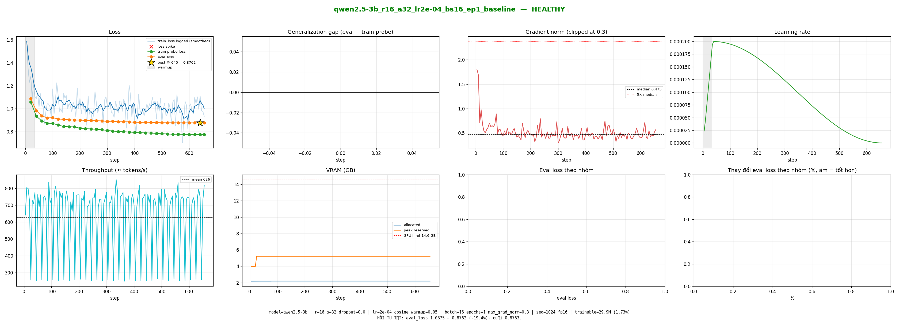

# Báo cáo SFT `qwen2.5-3b_r16_a32_lr2e-04_bs16_ep1_baseline_20261012-071208`

**Chẩn đoán: `HEALTHY`.** HỘI TỤ TỐT: eval_loss 1.0875 → 0.8762 (-19.4%), cuối 0.8763.

## 1. Specs

`model=qwen2.5-3b | r=16 α=32 dropout=0.0 | lr=2e-04 cosine warmup=0.05 | batch=16 epochs=1 max_grad_norm=0.3 | seq=1024 fp16 | trainable=29.9M (1.73%)`

- Dữ liệu: train 10563 mẫu · val 300 mẫu · train probe 150 mẫu · token trung bình 355.9, P95 632, max 5361
- Bước: 655 / 655 (warmup 34) · dừng sớm: False · thời gian 124.0 phút
- Môi trường: Tesla T4, fp16, torch 2.11.0+cu128, transformers 5.16.1, trl 1.13.0, unsloth 2026.10.3

## 2. Chỉ số sức khỏe

| Chỉ số | Giá trị | Khỏe khi |
|---|---|---|
| eval_loss_first → best → final | 1.0875 → 0.8762 (step 640) → 0.8763 | giảm rồi đi ngang |
| improvement_pct | 19.4% | ≥ 5% |
| overfit_rise_pct | 0.0% | ≤ 5% |
| train probe loss cuối | 0.7752 | thấp hơn eval một chút |
| train loss lúc train (log) | 0.9997 | chỉ để tham khảo |
| generalization_gap (eval − probe) | 0.1011 | nhỏ, không tăng dần |
| steps_to_90pct | 220 | nhỏ = hội tụ nhanh |
| loss_spikes / NaN steps | 0 / 0 | 0 / 0 |
| grad_norm p50 / p95 / max | 0.475 / 0.726 / 1.798 | max không gấp nhiều lần p95 |
| tokens/s trung bình | 626 | để so chi phí |
| VRAM đỉnh | 5.2 / 14.6 GB | dưới giới hạn |

## 3. Eval loss theo nhóm (trước = mô hình gốc, sau = checkpoint tốt nhất)

_Không đo được eval loss theo nhóm._

Nhóm giảm nhiều = mô hình học được hành vi đó. Nhóm gần như không đổi hoặc tăng = cần thêm dữ liệu hoặc kiểm tra nhãn.

## 4. Biểu đồ

**Cách đọc:** cam (eval) và xanh lá (train probe) cùng giảm là học tốt; cam đi lên trong khi xanh lá vẫn giảm là overfit; cả hai cao và phẳng là underfit. Loss lúc train (xanh nhạt) có thể bị phóng đại theo hệ số gom batch, đừng so trực tiếp với eval.